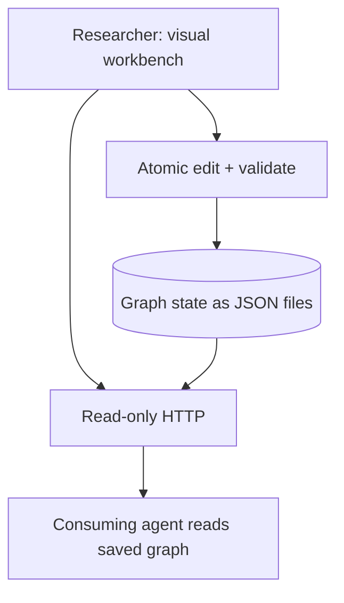

# Graphloom — Simplified Design

Status: reviewed  
Date: 2026-11-26  
Working name: Graphloom / 图思

## 1. Purpose

Graphloom is a local, single-user workbench for building, inspecting, and saving a visual-rhetoric ontology and its knowledge graph, and for exposing that saved graph to a consuming agent through a read-only interface.

The MVP has two responsibilities:

1. Let the researcher build, inspect, edit, and save the ontology and graph through the visual workbench.
2. Let a consuming agent read that saved graph — definitions, instances, relations, and their metadata.

What an agent does after reading is intentionally unspecified. There is no built-in modeling assistant, no agent write interface, no interpretation/generation/reasoning feature, and no MCP server. A model-backed consumer remains a later, consumer-side choice; it never requires the workbench to run a model.

The boundary reflects the researcher's clarification. Stack and contract details below are proposed engineering choices, not an accepted ontology or a downstream use of the graph.

## 2. MVP scope

### Included

- Create/open locally stored projects (one file per project) and switch between them.
- Create, edit, deprecate, and delete classes, relation types, attribute types, instances, and their assertions.
- Inspect the model and instances in linked graph and table views.
- Search objects; inspect a bounded neighborhood, incoming references, and instances of a class.
- Save edits as one atomic, validated batch; a failed batch changes nothing.
- Persist the current state to disk and keep the previous saved state as a backup file.
- Serve a read-only view of the saved graph to a local consuming agent.

### Deferred / out of scope

- PDF/OCR, corpus extraction, embeddings, GraphRAG, automatic literature discovery.
- Agent-assisted construction, natural-language editing, AI change proposals, agent write access.
- Any downstream agent task (interpretation, creation, reasoning, recommendations).
- Image annotation/analysis/generation; a dedicated Banksy workflow.
- OWL editor, arbitrary RDF import, formal reasoning, SPARQL.
- Multi-user collaboration, hosted accounts, public deployment, cross-machine sync.
- Revision history, named snapshots, branching/merging, three-way merge.
- RDF/Turtle export and native import/merge — the saved JSON file itself is the portable format.
- Neo4j, PostgreSQL, Redis, Celery, Docker.

Do not prepopulate disciplinary categories or present proposed examples as findings. Technical fixtures must be clearly synthetic and live outside the research dataset.

## 3. Architecture

A single local process. The backend binds to `127.0.0.1`; the packaged frontend is served from the same origin. There is no credential system: loopback access is trusted and single-user. Writes happen through the workbench; the consuming agent is given only read operations.



| Layer | Proposed selection | Responsibility |
| --- | --- | --- |
| Browser | React, TypeScript, Vite | Navigation, forms, graph/table projections |
| Graph rendering | Cytoscape.js (one renderer) | Selection, neighborhood display, explicit layout |
| API | FastAPI + Pydantic v2 | Typed read/edit contracts, OpenAPI, request limits |
| Domain | Plain Python services | Validation, atomic batches, bounded queries |
| Storage | One JSON file per project | Durable current state, atomic write + previous-state backup |
| Agent access | Read-only HTTP GET | No auth, no model runtime |
| Verification | pytest; Vitest where useful | Mutation correctness and a real reader client |

Run locally as one backend worker and a browser frontend. In development, Vite proxies `/api` to the backend; when packaged, FastAPI serves the built frontend under the same origin.

Use `uv` with a project-local environment and Python 3.13 unless dependency compatibility requires a documented supported version, following the inherited Python preflight. Never install into Apple Python, Homebrew Python, or the bundled Codex artifact runtime. Use npm with a committed lockfile for the frontend.

Proposed layout, relative to `graphloom/`:

```text
docs/design.md                 This specification
frontend/                      React application, package.json, package-lock.json
backend/                       pyproject.toml, uv.lock, app/, tests/
backend/app/                   HTTP, domain, storage
examples/                      Synthetic fixtures and a read-only consumer example
.env.example                   Configuration names with placeholders
.gitignore                     Runtime data, build outputs
```

Runtime data lives in an ignored `graphloom/.local/` directory. Keep research materials in their current locations and store references when needed; do not copy or modify proposal files as part of application initialization.

## 4. Domain model

Each project has an id, name, description, a monotonically increasing `version` (increments on each successful save), and `saved_at`. It owns ontology definitions and instances together.

All graph objects have an immutable id, a `kind`, timestamps, and a `status` of `active` or `deprecated`. Named objects also have `label`, `definition`, and `aliases`. Any object may carry `notes` and source references.

| Kind | Required payload beyond common metadata | Meaning |
| --- | --- | --- |
| `class` | `label`, `definition`, `aliases`, `parent_ids` | A user-defined category; multiple parents allowed |
| `relation_type` | `label`, `definition`, `aliases`, `domain_ids`, `range_ids` | A user-defined directed relation between instances |
| `attribute_type` | `label`, `definition`, `aliases`, `domain_ids`, `value_type` | A user-defined literal-valued property |
| `instance` | `label`, `definition`, `aliases`, `class_ids` | A particular object, initially allowed to be untyped |
| `relation` | `source_id`, `relation_type_id`, `target_id` | One directed assertion connecting two instances |
| `attribute_value` | `subject_id`, `attribute_type_id`, `value` | One literal assertion about an instance |
| `source_ref` | `label`, `locator`, `citation_text`, `evidence_state` | A reference to supplied material; not automatic verification |

`value_type` is one of `string`, `number`, `boolean`, `date`, or `uri`; dates use ISO `YYYY-MM-DD` strings. Multiple values use multiple `attribute_value` records. A URI literal does not create a graph edge. Relations and literal assertions have their own ids so parallel assertions can carry distinct notes and sources.

The MVP distinguishes ontology definitions from instance assertions: named classes, hierarchy, typed relations, and typed attributes — not arbitrary OWL expressions. Schema-view edges are derived from parent/domain/range fields. An arbitrary canvas edge never silently becomes an instance assertion or an OWL axiom.

`source_ref.locator` is a discriminated object: `url`, `workspace_relative_path`, `zotero_key`, or `free_text`, with a string value. The MVP stores it without fetching the target. Evidence states follow the workspace: `discovered`, `bibliographically_verified`, `abstract_preview_verified`, `full_text_verified`, `secondary_only`, plus `unverified` for an unfinished reference. Read responses preserve the stored state; exposing a reference does not verify it. There is no separate review-status field in the MVP — mark uncertainty through notes and the reference evidence state.

### Integrity

Hard errors reject a batch atomically: malformed fields, unknown or cross-project references, references to the wrong object kind, duplicate ids, changing an object's kind, literal datatype mismatch, and cycles in `parent_ids`. This hierarchy rule defines the MVP representation; it is not a claim that cyclic subclass axioms are universally invalid in RDF/OWL.

Advisory warnings allow exploratory work: missing definitions, duplicate labels, untyped instances, domain/range mismatch, and use of deprecated definitions. Empty domain/range lists mean unrestricted. Multiple allowed classes mean **any listed class, including descendants**; this must never be serialized as several RDF domain axioms, which have different semantics.

Deleting a referenced object is rejected with an explicit dependency list unless the same batch removes or rewires all references. No implicit cascade. Deprecation preserves references. Renaming changes labels only. A split or merge is an explicit batch of creates, rewiring, and deprecations chosen by the researcher.

### Storage

Store a validated graph-state JSON document per project, written atomically (write a temp file, flush, rename) with the previous state kept as `<id>.bak`. Load into memory during a request; validate and run bounded queries on an in-memory copy. This favors simple atomic recovery over a normalized store. The envelope assumption is about 1,000 instances and 5,000 assertions per project — an engineering scope, not a measured claim. Revisit after actual use.

Canvas positions, selection, and viewport are not semantic objects. Save layout separately so a drag never changes the graph an agent reads.

## 5. Editing and saving

All semantic writes from the workbench go through one atomic batch endpoint: an ordered list of `create`, `update`, and `delete` operations.

- `create`: a caller-local `ref` beginning with `new:`, an object `kind`, and its complete editable `data`.
- `update`: an existing `id` and a map of fields to replace. Omitted fields remain unchanged; arrays replace the whole array; `null` clears a nullable field. Kind and identity cannot change.
- `delete`: an existing `id`.

New objects may reference another operation's `new:` identifier in the same batch. The backend resolves temporary references, validates the whole resulting state, and either applies it all or rejects with no change. Temporary ids never persist. Reject undefined or duplicate temporary references and conflicting multiple writes to one object.

The UI saves an ordinary form edit as one batch without an approval dialog. There is no prepare/commit ceremony, no idempotency key, and no revision-conflict handling — a single local user. A failed batch leaves the file and `version` unchanged.

The previous saved file is kept as `.bak` as a crash-safety net, not a snapshot feature. Server-side undo and history are deferred; the UI may keep an in-memory undo for unsaved form edits.

## 6. HTTP interface

Prefix: `/api/v1`. Generate OpenAPI from Pydantic models and expose interactive documentation. All reads return the project `version` and `saved_at` so a consumer can identify what it read.

| Method and path | Purpose |
| --- | --- |
| `GET /health` | Liveness |
| `GET /capabilities` | Versions, limits, supported kinds |
| `GET /projects` | List projects |
| `POST /projects` | Create a project |
| `GET /projects/{id}` | Project metadata and current version |
| `GET /projects/{id}/schema` | Classes, relation/attribute types, warnings |
| `GET /projects/{id}/state` | Full current state |
| `GET /projects/{id}/objects?kind=…&q=…&cursor=…` | Search/list objects |
| `GET /projects/{id}/objects/{oid}` | Full object with metadata |
| `GET /projects/{id}/neighborhood?id=…&depth=…&relation_type=…` | Bounded neighborhood |
| `GET /projects/{id}/instances?class_id=…&include_descendants=…` | Instances of a class |
| `GET /projects/{id}/references?id=…` | Incoming references to an object |
| `POST /projects/{id}/batch` | Atomic create/update/delete (workbench only) |
| `GET /projects/{id}/layout`, `PUT /projects/{id}/layout` | Read/save editor positions |

Bounded queries return ids, objects, `version`, and explicit truncation metadata; cap results at 500 objects. Schema dependencies and instance adjacency must stay distinguishable. No SQL, Cypher, SPARQL, or arbitrary code execution endpoint.

Error shape: `{"error":{"code":"…","message":"…","details":{}},"request_id":"…"}`. Use 404 for absent resources, 409 for dependency conflicts, 413 for size limits, and 422 for malformed queries or invalid edits.

There is no authentication. Because the service binds to loopback and is single-user, all endpoints are local. The consuming agent is given only the read operations above (a reader-only OpenAPI document); the batch endpoint is not part of that contract. This is a convention on a trusted loopback, not a security boundary — if the graph is later served to a remote agent, add credentials then.

## 7. Visual workbench

Three-pane layout: project/object explorer on the left, graph or table in the center, an inspector on the right. A connection panel shows the project id, the read-only endpoint, and the path of the saved JSON file so a local agent can also read it directly.

- **Model mode:** classes and derived hierarchy/domain/range connections, with schema dependencies visually distinct.
- **Instance mode:** instances and typed assertions. Selecting a class filters its instances; literal values appear in the inspector/table rather than cluttering the canvas.
- **Table alternative:** searchable object rows expose the same operations without canvas gestures.
- **Editor:** create/edit definitions and instances, choose reference targets from existing ids, show warnings inline. Connecting two instances opens a relation-type selector; canvas gestures never determine semantics automatically.
- **Read-access preview:** show the exact structured data the read endpoint returns for the current selection, so the researcher can verify what an agent would read without invoking a model.

Keep Cytoscape behind a `GraphCanvas` adapter that receives a projection and emits selection/edit intentions; forms and API objects never depend on Cytoscape internals. Run layout only on initial display or explicit request; saved edits must not reset zoom or rearrange the canvas. Poll the project `version` while the tab is active and refetch affected queries on change or focus. When a bounded projection hides data, show the hidden/truncated count.

## 8. Agent-readable contract

An agent receives structured saved graph data — not a screenshot and not a generated summary. The read surface exposes:

- Class, relation-type, and attribute-type definitions, hierarchy, and stable ids.
- Instances, class membership, directed relations, and literal values.
- Labels and definitions alongside ids so the returned structure is intelligible.
- Source references, notes, deprecation status, and evidence states, unchanged in meaning.
- Project id and `version` on every response, so the consumer can identify exactly what it read.
- Explicit pagination and truncation, so a partial view is never presented as the whole graph.

The read surface serves the same saved state the workbench uses. Unsaved forms, editor layout, and arbitrary workspace files are outside it. The UI's read-access preview calls this real endpoint, not a separately maintained sample.

Read sequence:

1. Get `/capabilities` and `/projects/{id}`.
2. Read the current `version` once; if a new version appears mid-read, finish with the one you started and refetch if needed.
3. Read the ontology definitions at that version.
4. Retrieve instances and assertions through `/state` or paginated `/objects`; use `/neighborhood`, `/instances`, and `/references` for local views.
5. Return the retrieved data unchanged apart from transport serialization.

The graph service needs no OpenAI dependency, key, model selection, prompt, or inference endpoint. A later OpenAI-backed consumer can wrap the read operations as tools or pass graph data to a model (see the OpenAI quickstart and function-calling documentation); that consumer-side integration must not expose write operations, and its task, prompts, and outputs are deliberately left open. Demonstrating real HTTP read access with a reader client is the MVP proof, not a paid model call.

## 9. Portability and data

The saved JSON file is the authoritative format. To move or back up a project, copy its file (and `.bak`). There is no separate export/import feature and no RDF projection in the MVP; both are deferred until a concrete need appears. Exclude the `.local/` directory and any runtime secrets from Git.

## 10. Implementation order and completion

These are software delivery checks, not a research evaluation framework.

### Slice 1 — Graph and API

Implement domain types, validation, the atomic batch, JSON persistence, and read queries. A test creates a class, a relation type, two synthetic instances, and a relation in one batch and reads them back after restart; a failed batch leaves no change.

### Slice 2 — Visual editing

Implement explorer, model/instance modes, inspector, table alternative, batch save, and saved layout. A label edit preserves object identity and references; a class change reveals affected instances; a save appears consistently in the graph, table, and read views.

### Slice 3 — Read access

Implement the reader-only OpenAPI document, the consumer example, and the read-access preview. The consumer retrieves schema, instances, directed relations, literals, and stored metadata, and receives the same saved data as the workbench. No model workflow or agent-generated changes.

### Required checks

- Integrity: bad reference, delete dependency, hierarchy cycle, batch atomicity, and datatype mismatch are rejected; failed batches change nothing.
- Read contract: a reader client performs no writes; pagination and query bounds are explicit.
- Persistence: a saved graph reopens after restart with identical data.
- Integration: exercise the real HTTP read interface from a separate process — do not substitute a hard-coded fixture. No paid model call required.

The MVP is complete when the researcher can construct, inspect, edit, save, and reopen a small knowledge graph, and a consuming agent can retrieve that saved graph through the read-only interface with enough structure and metadata to identify what it read — without modifying the graph. What the agent achieves with the data is not part of completion.

## 11. Decisions to revisit after first use

- Whether richer node widgets warrant replacing Cytoscape.js.
- Whether a bounded RDF/Turtle export or native import is needed for a concrete use.
- Whether history, snapshots, or branching is needed after real modeling.
- Whether graph size or query patterns justify a real graph database.
- Whether to add credentials when serving the graph to a remote agent.
- Whether and how to connect an OpenAI-backed consumer once its intended use is specified.

Keep these as future decisions. Build the visual workbench and its read-only access first.
