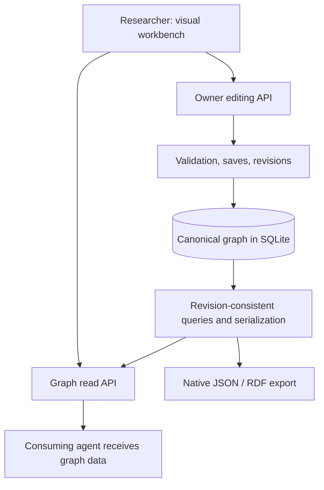

# Graphloom — MVP Design

Status: revised draft for review  
Date: 2026-11-25  
Working name: Graphloom / 图思

## 1. Product purpose and agreed direction

Graphloom is a workbench for constructing, visualizing, and maintaining an ontology and its knowledge graph. It exposes the resulting graph through a structured, read-only interface so that an agent can access it.

The research workflow is iterative: reading visual-rhetoric scholarship may change the proposed ontology; constructing a small graph makes those ideas inspectable and exposes questions to take back to reading. The workbench must make it inexpensive to build, inspect, query, revise, and recover a model while the research is still developing.

The MVP has two responsibilities:

1. Let the researcher build, inspect, edit, and save the ontology and graph through the visual workbench.
2. Let an agent read that saved graph, including its definitions, instances, relationships, and associated metadata.

What an agent does after reading the graph is intentionally unspecified. Do not design interpretation, generation, reasoning, graph construction, or other downstream agent tasks into this MVP. There is no built-in modeling assistant and no agent write interface.

OpenAI API is the researcher's current provider preference for eventual agent integration. That preference does not make AI assistance a graph-authoring feature. The graph read contract must remain usable by an OpenAI-backed consumer or any other HTTP client without requiring a model call to operate the workbench. A provider-specific application workflow remains undecided.

Throughout this document, a **development agent** implements the software; a **consuming agent** accesses the graph through the read interface. Permission to develop the software does not imply a product requirement for consuming agents to edit research data.

The product boundary above reflects the researcher's clarification. The stack, contracts, and implementation details below are proposed engineering choices. They do not define an accepted visual-rhetoric ontology or a downstream use of the graph.

## 2. MVP boundary

### Included

- Create a project with an empty model; switch between locally stored projects.
- Create, edit, deprecate, and explicitly delete classes, relation types, attribute types, instances, and their assertions.
- Inspect the model and instances in linked graph and table views.
- Search objects and inspect a bounded neighborhood, incoming references, and instances of a class.
- Save visual edits as atomic batches through the workbench's owner-authorized editing API.
- Preview a batch, apply it, view its diff, and recover a previous graph state.
- Expose read-only schema, object, relationship, and revision-consistent graph access to consuming agents.
- Persist everything needed to reopen the workbench; export and import native project data.
- Export a documented, limited RDF/Turtle projection for interoperability.

### Deferred

- PDF ingestion, OCR, corpus extraction, embeddings, GraphRAG, and automatic literature discovery.
- Agent-assisted graph construction, natural-language editing, AI-generated change proposals, and consuming-agent write access.
- Any downstream agent task using the graph, including interpretation, creation, reasoning, and recommendations. These are not assumed future deliverables.
- Image annotation, image analysis, image generation, and a dedicated Banksy workflow.
- A complete OWL editor, arbitrary RDF import, formal reasoning, and a SPARQL endpoint.
- Concurrent multi-user collaboration, hosted accounts, public deployment, and synchronization across machines.
- A built-in general-purpose chat application, autonomous background agents, and multi-agent orchestration.
- Branch merging, automatic instance migrations, and one-click concept merging or splitting.
- Neo4j, PostgreSQL, Redis, Celery, and a mandatory Docker installation.
- An MCP server. The first integration contract is HTTP/OpenAPI; a later MCP adapter must reuse it.

Do not prepopulate disciplinary categories or treat proposed examples as findings. Technical fixtures must be clearly synthetic and live outside the research dataset.

## 3. Reference projects and concrete reuse plan

These projects are technical references, not dependencies to deploy together. The review covered repository documentation and selected source entry points; none was installed or operationally validated for this design. Links point to moving branches. Before reusing code, record the exact upstream commit and preserve its license notices.

| Reference | Verified implementation or documented behavior | Apply to Graphloom | Boundary |
| --- | --- | --- | --- |
| [OntoSphere](https://github.com/boricles/ontosphere) | React/TypeScript/Vite, Cytoscape.js, FastAPI; documented graph editing, version snapshots, comparisons, rollback, and RDF export. | Use its editor/inspector and version-history interactions as a reference. Separate graph mutations, revision services, and serialization. | Do not inherit its document-first workflow or PostgreSQL/AGE, Redis, and Celery stack. Its documentation is not proof of lossless general OWL handling. |
| [Microsoft Ontology Playground](https://github.com/microsoft/Ontology-Playground) | Visual designer, live graph preview, undo/redo, and bounded editing of imported RDF. Its [package manifest](https://github.com/microsoft/Ontology-Playground/blob/main/package.json) includes Cytoscape.js, fCoSE, React, and Zustand. | Reference the coordinated graph/form editing and layout behavior. Keep visual projection separate from semantic data. | Do not inherit Fabric IQ assumptions, its catalogue, or its optional Azure Functions deployment. |
| [Neo4j LLM Graph Builder](https://github.com/neo4j-labs/llm-graph-builder) | Its [backend entry point](https://github.com/neo4j-labs/llm-graph-builder/blob/main/backend/score.py) exposes schema and neighborhood access alongside its generation functions. | Reference only the graph inspection endpoints and the separation of graph data from its visual presentation. | Its LLM extraction, schema generation, and model orchestration are outside this MVP. Neo4j is not required. |
| [Cytoscape.js](https://js.cytoscape.org/) | Graph visualization, layouts, selection, and graph interaction primitives. | Use as the one graph renderer; wrap it behind a small React component. | The renderer's node/edge JSON is not the canonical research model. |
| [RDFLib](https://github.com/RDFLib/rdflib) | RDF graph construction and serializers including Turtle. | Use for the explicitly bounded export in Section 10. | Serialization is not an ontology reasoner or a substitute for provenance. |

Additional reading: [OntoSphere features and stack](https://github.com/boricles/ontosphere#features) and [Ontology Playground designer](https://github.com/microsoft/Ontology-Playground#visual-ontology-designer). Reference projects' AI features are not Graphloom requirements.

React Flow remains a reasonable alternative if rich, form-like nodes become central. Use Cytoscape.js for the MVP because graph inspection, neighborhoods, and model/instance projections are the immediate priority. Do not introduce both renderers initially.

## 4. Architecture and development environment



| Layer | Proposed selection | Responsibility |
| --- | --- | --- |
| Browser | React, TypeScript, Vite | Navigation, forms, graph/table projections, change preview |
| Graph rendering | Cytoscape.js + fCoSE | Selection, neighborhood display, explicit automatic layout |
| Client state | TanStack Query; small Zustand store | Server-state fetching/invalidation; local selection, layout, and unsaved form state |
| API | FastAPI + Pydantic v2 | Typed read/edit contracts, separate authorization, request limits, OpenAPI |
| Domain | Plain Python services | Referential integrity, queries, change sets, snapshots, diffs |
| Storage | SQLite + SQLAlchemy + Alembic | Durable local state and transactional revision history |
| Agent access | HTTP/OpenAPI | Provider-independent, read-only graph access; no model runtime in the workbench |
| Export | RDFLib | Bounded RDF projection |
| Verification | pytest; Vitest where useful; Playwright | Mutation correctness and end-to-end user flows |

Run locally as a single backend worker and a browser frontend. During development, Vite proxies `/api` to the backend. For a packaged local run, FastAPI serves the built frontend under the same origin. Bind to `127.0.0.1` by default.

Use `uv` with a project-local environment and Python 3.13 unless dependency compatibility requires a documented supported version. Follow the inherited Python preflight before running or installing Python dependencies. Never install into Apple Python, Homebrew Python, or the bundled Codex artifact runtime. Use npm with a committed lockfile for the frontend; preserve another convention if one exists when implementation begins. Resolve compatible versions once and lock them rather than copying version numbers from reference repositories.

Proposed layout, relative to the existing `graphloom/` directory:

```text
docs/design.md                 This specification
frontend/                      React application, package.json, package-lock.json
backend/                       pyproject.toml, uv.lock, migrations, app/, tests/
backend/app/api/                HTTP routers and authentication
backend/app/domain/             Models, validation, commands, queries, diffs
backend/app/storage/            SQLAlchemy models and persistence
backend/app/exports/            Native and RDF serializers
examples/                      Synthetic fixtures and read-only consumer example
.env.example                   Configuration names with placeholders
.gitignore                     Secrets, runtime data, build outputs
```

Runtime data belongs in an ignored `graphloom/.local/` directory. Keep existing research materials in their current locations and store references when needed. Do not copy or modify proposal files as part of application initialization. Keep any future README concise; put operating instructions in an applicable AGENTS.md when implementation establishes them.

## 5. Domain model

### 5.1 Project and graph objects

Each project has an immutable UUID, name, description, and monotonically increasing integer `revision`. It owns its ontology and instances together, allowing a revision to reconstruct both. New projects start at revision 0 with an empty graph.

All graph objects have an immutable UUID, immutable `kind`, project ownership, timestamps, `created_by`, `updated_by`, `origin` (`human`, `import`), `review_status` (`proposed`, `accepted`, `questioned`), and `lifecycle` (`active`, `deprecated`). Named objects have `label`, `definition`, and `aliases`. Every object may have notes and source-reference IDs. For ordinary edits, backend code stamps actor metadata from the authenticated owner. `origin` records initial creation, while later edits are recorded in revisions. Native import and restoration preserve original object provenance as historical metadata and record the importing/restoring actor separately in the new revision; imported actor labels confer no local permissions.

Review status records a researcher's decision about a working object. It is distinct from structural validity and from whether an edit has been saved. New objects may remain `proposed` while modeling is exploratory; this does not imply AI authorship. Missing evidence is allowed and must remain visible in both the UI and the read API.

| Kind | Required payload beyond common metadata | Meaning |
| --- | --- | --- |
| `class` | `label`, `definition`, `aliases`, `parent_ids` | A user-defined category; multiple parents allowed |
| `relation_type` | `label`, `definition`, `aliases`, `domain_ids`, `range_ids` | A user-defined directed relation between instances |
| `attribute_type` | `label`, `definition`, `aliases`, `domain_ids`, `value_type` | A user-defined literal-valued property |
| `instance` | `label`, `definition`, `aliases`, `class_ids` | A particular object, initially allowed to be untyped |
| `relation` | `source_id`, `relation_type_id`, `target_id` | One directed assertion connecting two instances |
| `attribute_value` | `subject_id`, `attribute_type_id`, `value` | One literal assertion about an instance |
| `source_ref` | `label`, `locator`, `citation_text`, `evidence_state` | Optional reference to supplied material; not automatic evidence verification |

`value_type` is one of `string`, `number`, `boolean`, `date`, or `uri`; dates use ISO `YYYY-MM-DD` strings. Multiple values use multiple `attribute_value` records. A URI literal does not create a graph edge. Relations and literal assertions have their own IDs so parallel assertions can carry distinct notes, sources, and review status.

The MVP distinguishes ontology definitions from instance assertions. It supports named classes, hierarchy, typed relations, and typed attributes, not arbitrary OWL expressions. User-defined relations connect instances; schema-view edges are derived from parent/domain/range fields. Do not let an arbitrary canvas edge silently become an instance assertion or an OWL axiom.

`source_ref.locator` is a discriminated object: `url`, `workspace_relative_path`, `zotero_key`, or `free_text`, with a string value. The MVP stores it without fetching the target. Evidence states follow the workspace: `discovered`, `bibliographically_verified`, `abstract_preview_verified`, `full_text_verified`, `secondary_only`, plus `unverified` for an unfinished reference. Read responses preserve the stored evidence state; exposing a reference does not verify its contents.

### 5.2 Integrity and exploratory constraints

Hard errors reject a change set atomically: malformed fields, unknown references, cross-project references, references to the wrong object kind, duplicate IDs, changing an object's kind, literal datatype mismatch, and cycles in `parent_ids`. This hierarchy rule defines the MVP representation; it is not a claim that cyclic subclass axioms are universally invalid in RDF/OWL.

Warnings allow exploratory work: missing definitions, duplicate labels, untyped instances, domain/range mismatch, and use of deprecated definitions. Empty domain/range lists mean unrestricted. For the application's advisory checks, multiple allowed classes mean **any listed class**, including descendants. This must not be serialized as several RDF domain axioms, which would have different semantics.

Deleting a referenced object is rejected with an explicit dependency list unless the same batch removes or rewires all references. No implicit cascade. Deprecation preserves references. Renaming changes labels only. A split or merge is an explicit batch of creates, rewiring, and deprecations selected by the researcher; the application does not guess which instances should move.

Editing domain/range or hierarchy recomputes affected warnings without rewriting instance types. The preview shows affected instance/assertion IDs and warning counts, including when only the schema object itself changed.

### 5.3 Storage strategy

For the small local MVP, store a validated canonical `GraphState` JSON document per project in SQLite. Its objects are indexed by ID in memory during a request. Keep separate relational tables for projects/current state, immutable revisions, named snapshots, change sets, credentials, and view layouts. Each revision stores the resulting complete graph state, canonical diff, actor, timestamp, and reason. This deliberately favors simple atomic recovery over a normalized graph store.

Use foreign keys for relational metadata, WAL mode, a busy timeout, and short write transactions. Validation and bounded graph queries operate on an immutable state copy. Snapshot cost is acceptable at the proposed initial envelope of 1,000 instances and 5,000 assertions per project; this is an engineering scope assumption, not a measured performance claim. Revisit storage after actual use demonstrates a need.

Canvas positions, selection, and viewport are not semantic objects. Save layouts separately with their own version so a node drag does not change the semantic graph revision seen by a consuming agent.

## 6. Workbench editing and persistence

All semantic writes from the owner's workbench use a `ChangeSet`. This is an implementation mechanism for consistent saves and recovery, not an agent tool or an AI proposal workflow. Consuming-agent credentials cannot prepare or commit changes, import data, restore snapshots, or otherwise write state.

### 6.1 Operation format

The common command envelope has `base_revision`, `reason`, and an ordered `operations` list. Operations are a discriminated union:

- `create`: a caller-local `ref` beginning with `new:`, an object `kind`, and its complete editable `data`.
- `update`: an existing `id` and a typed map of fields to replace. Omitted fields remain unchanged; arrays replace the whole array; null only clears nullable fields. Kind and identity cannot change.
- `delete`: an existing `id`.

New objects can reference another operation's `new:` identifier in the same batch. The backend allocates UUIDs once during preparation, resolves all temporary references, and persists the normalized operations and `id_map`. The editor uses this mechanism to save related changes together. Temporary IDs never appear in persisted graph state. Reject undefined or duplicate temporary references and conflicting multiple writes to one object in a batch.

Example command against an empty project; the class is a synthetic technical fixture:

```json
{
  "base_revision": 0,
  "reason": "Create a synthetic class for a modeling trial",
  "operations": [
    {
      "op": "create",
      "ref": "new:sample-class",
      "kind": "class",
      "data": {
        "label": "Sample category",
        "definition": "Synthetic fixture; not a research claim.",
        "aliases": [],
        "parent_ids": [],
        "notes": "",
        "source_ref_ids": [],
        "review_status": "proposed",
        "lifecycle": "active"
      }
    }
  ]
}
```

### 6.2 Prepare, inspect, commit

1. Prepare a candidate against its exact `base_revision`, allocate IDs, and validate the final resulting state. Return a persisted change-set ID, normalized operations, diff, impacted IDs, errors, warnings, and an immutable payload hash.
2. If a caller edits the candidate, prepare a new change set. A prepared payload is immutable.
3. Commit by change-set ID with `expected_revision` and an `Idempotency-Key`.
4. In one SQLite write transaction, compare the current revision, revalidate, update state, append the revision/diff, mark the change set committed, and persist the idempotency result.
5. Publish the committed revision to readers. Failed or empty batches do not advance the revision.

The UI prepares and commits an ordinary explicit form save without an extra approval dialog. Show a diff preview for bulk edits, import replacement, and restoration. The researcher does not need to see the internal change-set protocol during routine editing. Only owner credentials can invoke these endpoints; they must not appear in the agent-facing capability description or tool manifest.

Stale commits return `409 revision_conflict` with expected/current revisions and a link to intervening changes. No automatic rebase. The client refreshes and submits a new candidate. Scope idempotency keys to actor and project; an identical retry returns its original commit result even if the project subsequently advances, while key reuse with different input returns `409 idempotency_conflict`.

### 6.3 History and recovery

Named snapshots point to immutable revisions. Comparing two revisions returns added/deleted objects and field-level changes. Restoring a snapshot prepares a replacement-state change set against the current revision, with a complete diff. Committing it creates a new higher revision; it never erases history or moves the revision counter backward.

MVP Undo restores the immediately preceding semantic revision only when the current revision is the user's last committed change; otherwise offer the history/diff view. Unsaved form edits and layout edits have their own local undo. Do not silently undo another client's intervening work. Branches and three-way merge are deferred.

## 7. HTTP API and access boundaries

Prefix: `/api/v1`. Generate OpenAPI from Pydantic models and expose interactive API documentation. `/health`, `/capabilities`, `/projects`, and `/projects/{project_id}` below are relative to that prefix. All remaining table paths are relative to `/api/v1/projects/{project_id}`.

| Method and path | Purpose | Access |
| --- | --- | --- |
| `GET /health` | Liveness; excludes secrets and graph content | Public local health check |
| `GET /capabilities` | API/format versions, limits, supported kinds, permitted read operations | Owner or reader; filtered by credential |
| `GET /projects` | List accessible projects | Owner or reader; filtered by credential |
| `POST /projects` | Create a local project | Owner only |
| `GET /projects/{project_id}` | Project metadata and current revision | Owner or reader |
| `GET /state?revision=N` | Consistent full native state; omit revision for current | Owner or reader |
| `GET /schema?revision=N` | Classes, relation types, attribute types, and warnings | Owner or reader |
| `GET /objects?kind=...&q=...&cursor=...&revision=N` | Search/list objects | Owner or reader |
| `GET /objects/{id}?revision=N` | Full object with metadata | Owner or reader |
| `POST /query` | Typed, bounded, read-only graph queries | Owner or reader |
| `POST /change-sets` | Prepare and validate an editor save | Owner only |
| `GET /change-sets/{id}` | Read pending editor changes, diff, and validation | Owner only |
| `POST /change-sets/{id}/commit` | Atomic save with revision and idempotency checks | Owner only |
| `GET /revisions?after=N` | Ordered committed changes since revision N | Owner or reader |
| `GET /diff?from=N&to=M` | Compare saved semantic states | Owner or reader |
| `GET /snapshots` | List named saved revisions | Owner or reader |
| `POST /snapshots` | Name an immutable revision reference | Owner only |
| `POST /snapshots/{id}/restore-preview` | Prepare recovery as a change set | Owner only |
| `GET /export?format=native-json\|turtle&revision=N` | Export a consistent state | Owner or reader |
| `POST /import-preview` | Validate native JSON and prepare replacement of this project's state | Owner only |
| `GET /layout`, `PUT /layout` | Read/save editor positions with separate version checks | Owner only |

Every semantic read returns `revision`. Paginated cursors bind to an immutable revision and a stable ID ordering. Never page across a changing current graph. Clients may refetch current state after observing a new revision. Proposed default page size is 100, maximum 500.

`POST /query` accepts a typed query object and optional pinned revision. Implement `neighbors` (IDs, direction, relation-type filter, depth up to 2), `instances_of` (class ID, include descendants), and `references_to` (object ID). Return IDs, objects, revision, and explicit truncation metadata. Bound results to 500 objects per request. Schema dependencies and instance adjacency must remain distinguishable in the result. No SQL, Cypher, SPARQL, or arbitrary code execution endpoint in the MVP.

Error shape: `{"error":{"code":"revision_conflict","message":"...","details":{}},"request_id":"..."}`. Use 401/403 for credentials/access, 404 for absent resources, 409 for conflicts/dependencies, 413 for size limits, 422 for malformed queries or invalid edits, and 429 for local request limits. Prepared editor changes with structural errors can still be stored and returned as `invalid`; commit must reject them with 422.

Provide a small reader-authenticated HTTP client example showing: select a project → pin its revision → read schema → retrieve instances and relationships → inspect a neighborhood. It must work without an OpenAI key and must not prepare or commit edits. Publish a reader-only OpenAPI document, derived from the same route definitions, for consuming-agent integration. Server authorization must still reject owner operations even if an agent discovers their URLs.

## 8. Visual workbench

Use a three-pane layout: project/object explorer on the left, graph or table in the center, and an inspector on the right. A compact lower drawer contains history and bulk-edit previews. A connection panel shows the project identifier, reader API instructions, and an owner-controlled way to create or revoke a reader credential.

- **Model mode:** classes and derived hierarchy/domain/range connections. Selecting a relation type opens its definition and allowed endpoints. Give schema dependencies distinct visual styles.
- **Instance mode:** instances and typed assertions. Selecting a class filters its instances; selecting an assertion exposes its own metadata. Literal values appear in the inspector/table rather than generating clutter by default.
- **Table alternative:** searchable object rows and accessible editing controls expose the same operations without requiring canvas gestures.
- **Editor:** create/edit definitions and instances, choose reference targets from existing IDs, and show warnings inline. Connecting two instances opens a relation-type selector. Canvas gestures never determine domain semantics automatically.
- **Change preview:** distinguish additions, removals, and updates; show affected references and warnings; allow Apply or Discard. Corrections create a new preview.
- **History:** name a snapshot, compare revisions, preview restoration, and restore.
- **Read-access preview:** inspect the structured saved data returned by the reader API for the current selection and revision. This lets the researcher verify what an agent can read without choosing an agent task or invoking a model.

Keep Cytoscape behind a `GraphCanvas` adapter that receives a projection and emits selection/edit intentions. Form and API objects must never depend on Cytoscape's internal element representation. Persist user positions; run fCoSE only on initial display or explicit layout requests. Saved edits should not reset zoom or rearrange the whole canvas.

Poll project revision every two seconds while the tab is active; refetch affected queries on change, on window focus, and after reconnect. Retain unsaved forms and surface conflicts instead of overwriting them. WebSocket collaboration is unnecessary for the MVP. If a filtered or bounded projection hides data, show the hidden/truncated count.

## 9. Agent-readable graph contract and OpenAI boundary

### 9.1 What it means for an agent to see the graph

An agent receives structured saved graph data, not a screenshot of the visualization and not a generated summary standing in for the graph. The read surface must expose:

- Class definitions, hierarchy, relation-type definitions, attribute-type definitions, and their stable IDs.
- Instances, explicit class membership, directed relations, and literal values.
- Labels and definitions alongside IDs so the returned structure is intelligible.
- Stored source references, notes, lifecycle, and review/evidence states without changing their meaning.
- Project ID and revision on each response so the consumer can identify exactly what it read.
- Pagination, truncation, and unresolved boundary references explicitly, so a partial view is never presented as the whole graph.

Expose the same saved semantic state used by the workbench. Unsaved forms, pending change sets, editor layouts, credentials, and arbitrary workspace files are outside the reader contract. The read-access preview in the UI uses this actual API rather than a separately maintained sample representation.

### 9.2 Read sequence

1. Use a project-scoped reader credential to discover the permitted API capabilities and project metadata.
2. Read the current revision once and pin it for the rest of this sequence.
3. Read the ontology definitions at that revision.
4. Retrieve instances and assertions through the full-state endpoint or paginated object endpoints; use bounded queries for local neighborhoods and references.
5. Return the retrieved data to the consuming agent unchanged apart from transport serialization. What the agent does with it is outside Graphloom's MVP responsibility.

For example, a consumer can request `GET /api/v1/projects/{project_id}/schema?revision=12`, followed by `GET /api/v1/projects/{project_id}/objects?kind=instance&revision=12`. This is a data-access example, not a prescribed research task.

A neighborhood response must include the definitions needed to interpret its relation types and explicit references for anything outside the returned boundary. Do not include unrelated material by default. The full-state endpoint remains available when the consumer needs the complete small graph. Pagination must allow reconstruction of that same saved state without silently dropping objects or assertions.

If the researcher saves revision 13 while a consumer is reading revision 12, the remaining pinned reads continue to return revision 12. A subsequent explicit refresh can select revision 13. Reading must not create a semantic revision, alter review status, infer new edges, or persist model outputs.

### 9.3 OpenAI API remains a consumer-side choice

The current preference is to use the OpenAI API when a model-backed agent is connected. The graph service itself does not need an OpenAI dependency, key, model selection, prompt, assistant-run table, or inference endpoint for this MVP.

A later OpenAI-backed consumer can wrap the reader operations as function tools or pass retrieved graph data to a model. The developer would then consult the [OpenAI quickstart](https://developers.openai.com/api/docs/quickstart) and [function calling documentation](https://developers.openai.com/api/docs/guides/function-calling). That consumer-side integration must not expose the owner's editing credentials. Its task, prompts, outputs, and orchestration are intentionally left open here.

For this MVP, demonstrate integration with a real HTTP reader client using the same machine-readable contract an agent would use. This proves graph access, not that any particular model understands or usefully applies the graph. Do not introduce a graph-summary, interpretation, generation, or editing task merely to obtain a successful model response. A paid OpenAI call is not an MVP completion requirement.

### 9.4 Adapter boundary

Publish a reader-only OpenAPI document and a small client example. If tool descriptors are generated, include only project/schema/object reads and bounded read queries. Do not export editing, import, restoration, project creation, or credential-management operations to the consuming agent.

A future MCP adapter should delegate to the same read services. HTTP access is sufficient for the initial implementation; the choice of agent transport does not change graph storage or define what the agent will do with the data.

## 10. Export, import, and portability

Native JSON is the authoritative interchange format. Include `format_version`, project ID/name/description, exported revision, graph objects, and optional layout for owner exports. Reader exports omit layout and other owner-only data. Exclude credentials and runtime configuration from all exports. Validate size, version, IDs, kinds, and references before preparing an owner-authorized import. Never mutate on parse failure.

MVP import replaces the selected project's graph through a previewed change set; it does not merge. Keep the target project's identity and revision sequence, preserve graph-object UUIDs, and record the source project/revision as import metadata. Start with an empty project to create an independent alternative. History remains available in the database; state export is not advertised as a complete history backup.

RDF/Turtle export is a secondary projection using stable IRIs based on project and object UUIDs:

- Classes → `owl:Class`; parent links → `rdfs:subClassOf`.
- Relation types → `owl:ObjectProperty`; attribute types → `owl:DatatypeProperty`.
- Instances → resources with explicit `rdf:type` statements.
- Instance relations → predicate triples; literal assertions → typed literals.
- Names/definitions → `rdfs:label` / `rdfs:comment`.
- Assertion identities and review/source metadata → additional reified statement records and a documented Graphloom vocabulary.

Do not export advisory domain/range lists as OWL/RDFS restrictions in the MVP. Serialize them as Graphloom metadata and include an export warning explaining this choice. Duplicate assertions may collapse to one base triple, so their separate reified records must preserve identity. Deprecated/proposed objects retain their status annotations. RDF export does not claim that an assertion is verified. JSON remains the exact round-trip format; arbitrary OWL/RDF import and reasoning are deferred.

## 11. Local access and operational behavior

Use two credential roles: `owner` for the researcher's workbench and `reader` for consuming agents. Reader credentials are restricted to specified projects and cannot be upgraded through the reader API. Store token hashes server-side. A local setup command creates the owner token; the browser enters it once per session and retains it in memory. An owner-only settings endpoint or local command creates and revokes reader credentials. This is a small local access mechanism, not an account-management product.

The backend checks every protected request. `POST /query` is read-only despite its HTTP method; all editing and management routes require owner authorization. Bind to loopback, allow only configured frontend origins, and serve the packaged UI from the API origin. Render user labels and notes as escaped text or sanitized Markdown. Source paths are references, not permission to read arbitrary local files. Require explicit asset-handling design before adding file-serving endpoints.

State persists across restarts. Back up SQLite with a consistent backup mechanism, not by copying a live WAL database's main file alone. Exclude runtime databases, keys, logs, and caches from Git. Graph editing and local reader access work without an OpenAI account or internet connection.

## 12. Implementation sequence and completion checks

These are software delivery checks, not a research evaluation framework or evidence of better image interpretation.

### Slice 1 — Headless graph and API

Implement domain types, SQLite migrations, owner editing services, integrity checks, revision conflicts, idempotency, and read queries. An owner-authenticated test client can create a class, relation type, two synthetic instances, and a relation in one batch, then retrieve the result after restart. A failed batch leaves no partial state or revision. A reader-authenticated client can retrieve the saved data but cannot write it.

### Slice 2 — Visual editing

Implement explorer, model/instance modes, inspector, table alternative, manual CRUD via change sets, and saved layout. Editing a label preserves object identity and its references. A class definition change reveals affected instances. A save appears consistently in the visual, tabular, and read-API representations. Changes saved in another owner browser tab must not silently discard unsaved input.

### Slice 3 — Recovery and portability

Implement diffs, snapshots, restore previews, native JSON import/export, and bounded Turtle export. Native round-trip preserves all graph-object IDs, values, source references, review states, and topology; only target project identity and revision history differ on import. Restoring an older state creates a new revision and retains intervening history.

### Slice 4 — Consuming-agent read access

Implement reader credentials, reader-only OpenAPI, the small HTTP consumer example, and the UI read-access preview. The consumer retrieves schema, instances, directed relations, literals, and stored metadata from a pinned revision. It receives the same saved semantic data as the workbench, including explicit pagination and truncation information. All owner operations are rejected for reader credentials. No model workflow or agent-generated changes are required.

### Required implementation verification

- Transaction tests: invalid reference, delete dependency, hierarchy cycle, multi-object atomicity, competing revisions, duplicate commit retries, and restore behavior.
- Domain tests: class/instance separation; parallel assertion identity; advisory domain/range mismatches; retained evidence/review metadata.
- API tests: project isolation, owner/reader separation, reader credential revocation, revision-pinned pagination, query bounds, native import failure, and offline operation without OpenAI. Assert that readers cannot create projects, prepare/commit edits, import, restore, save layouts, or manage credentials.
- Reader consistency tests: reconstruct a saved graph through pagination and compare with full state; preserve IDs, edge direction, types, literal values, and metadata; continue reading an older pinned revision while an owner saves a new one. Assert that reading leaves graph state and revision unchanged.
- Browser flows: manual creation, rename, query/selection, saved-data preview, conflict display, snapshot restoration, and reopen persistence.
- Integration check: exercise the actual HTTP reader interface from a separate process. Do not substitute a hard-coded JSON fixture for proof that the saved graph is accessible. No paid model call or downstream agent task is required.

The MVP is complete when the researcher can construct, inspect, edit, save, and reopen a small knowledge graph, and a consuming agent can retrieve that saved graph through the read-only interface. The reader must receive enough structure and metadata to identify what it read, without modifying the graph. No claim about what the agent can achieve with that data is part of completion.

## 13. Decisions to revisit after first use

- Whether graph editing benefits from richer node widgets enough to replace Cytoscape.js.
- Whether native JSON plus bounded RDF export is sufficient, or formal OWL/SHACL authoring is needed.
- Whether repeated modeling work needs branches, reusable templates, or merge/split commands.
- Whether real graph size or query patterns justify normalized storage or a dedicated graph database.
- Whether an MCP adapter materially improves the chosen agent workflow.
- Whether and how to connect an OpenAI-backed consumer after its intended use has been specified.

Keep these as future decisions. Build the visual graph workbench and its read-only access first. Do not fill the deliberately open downstream-agent scope with assumed features.
